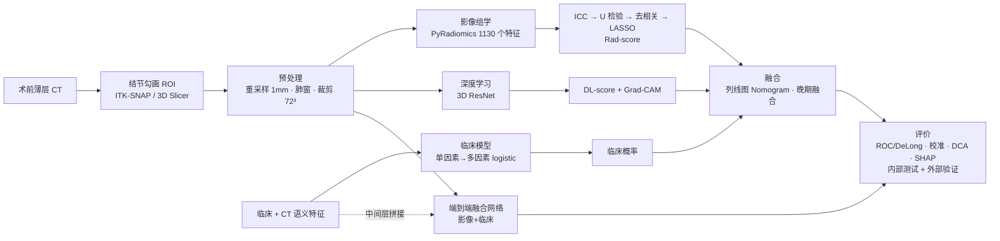

# 基于术前 CT 深度学习影像组学联合临床特征预测早期肺腺癌病理侵袭性 —— 初步方案

> MED5085《多模态医学数据分析与人工智能》Fall 2026 课程项目 · 初稿，供组内讨论

---

## 1. 一句话说清楚

**手术前**，用病人的 **CT 影像 + 临床信息**，预测这个肺结节切下来后的病理是
**AIS/MIA（原位/微浸润，“惰性”）** 还是 **IAC（浸润性腺癌）**。

## 2. 为什么值得做（临床背景）

- 按 IASLC/ATS/ERS 及 WHO 分类，肺腺癌从轻到重分为：AAH → **AIS** → **MIA** → **IAC**。
- AIS/MIA 术后预后非常好，可以考虑**亚肺叶切除**（楔形/肺段），保留更多肺功能；
  IAC 一般需要**肺叶切除 + 淋巴结清扫**。所以术前知道“浸不浸润”直接影响手术方案。
- 现在主要靠：① 医生看 CT（结节大小、实性成分比例 CTR 等），主观、经验依赖；
  ② 术中冰冻病理，对 MIA 和 IAC 的区分存在一定误差。
- **我们的目标**：做一个客观、无创、术前可用的预测模型，辅助外科医生规划手术。

## 3. 把医学问题翻译成机器学习问题

| 项目 | 定义 |
|---|---|
| 任务 | 二分类 |
| 输入（多模态） | ① CT 影像中的结节区域（ROI）② 临床信息（年龄、性别、吸烟、CEA）③ CT 语义特征（最大径、CTR、分叶、毛刺、胸膜凹陷、空泡） |
| 输出 | P(IAC)：该结节为浸润性腺癌的概率 |
| 标签（金标准） | 术后病理：0 = AIS + MIA，1 = IAC |
| 主要指标 | AUC（95% CI），另报准确率、敏感度、特异度、PPV、NPV、校准曲线、决策曲线 |

**建议的纳入/排除标准（需要和临床老师确认）**
- 纳入：术前 1 个月内薄层 CT（层厚 ≤ 1.5 mm）；结节最大径 ≤ 3 cm；术后病理确诊 AIS / MIA / IAC。
- 排除：术前接受过放化疗或穿刺；图像伪影严重；关键临床资料缺失；多发结节无法与病理一一对应。

## 4. 技术路线

### 和课程内容的对应（汇报时可以强调）

| 课程章节 | 我们项目里对应的部分 |
|---|---|
| Sec 2 机器学习基础 / 评价指标 | AUC、DeLong 检验、Youden 阈值、外部验证 |
| Sec 4 医学数据建模挑战 | 缺失值填补、类别不平衡（pos_weight）、多中心分布差异、数据泄露防范 |
| Sec 6 结构化数据 | 临床模型：单因素/多因素 logistic 回归、OR 值 |
| Sec 9 医学影像 | 影像组学 + 3D CNN（参考 Lab3 的 ResNet）+ Grad-CAM 可解释性 |
| Sec 12 多模态融合 | 三种融合策略对比：决策层（晚期）融合 / 特征层（列线图）/ 中间层（端到端网络） |
| Sec 15 多模态挑战 | 外部验证集（不同层厚、不同噪声的医院）、模态缺失 |
| Week 8 可解释 AI | SHAP、列线图 |

## 5. 四个模型 + 两种融合，各是什么

1. **临床模型**：把年龄、CEA、CTR 等变量做单因素 logistic 回归，p < 0.05 的进多因素，向后剔除，得到“独立危险因素”。医生最熟悉的方式。
2. **影像组学模型（Rad-score）**：PyRadiomics 从结节里算 1000+ 个手工定义的定量特征（形状、灰度、纹理），经过“ICC 稳定性 → 统计检验 → 去冗余 → LASSO”层层筛选，留下几个特征加权求和得到 Rad-score。
3. **深度学习模型（DL-score）**：3D ResNet 直接从 CT 结节块学特征，不需要人为定义特征；用 Grad-CAM 看模型关注哪里。
4. **端到端融合网络**：在同一个神经网络里，影像分支和临床分支的特征在中间层拼起来一起训练。
5. **列线图（Nomogram）**：临床独立危险因素 + Rad-score + DL-score 一起做多因素 logistic 回归，画成医生可以“查表打分”的列线图。这是这类文章最常见的最终模型。
6. **晚期融合**：三个单模态模型的概率直接平均，作为最简单的融合基线。

**防止数据泄露的设计**（老师可能会问）：所有特征筛选和模型拟合只在训练集上做；
训练集的 Rad-score / DL-score 用 5 折交叉验证的“折外预测”，避免融合模型“自己考自己”；
测试集和外部验证集全程不参与任何选择。

## 6. 数据：最大的不确定性

**现在代码跑的是模拟数据**（360 个虚拟病人，两家“医院”），只用来把流程调通。
真实数据可能的来源（需要组里尽快确认）：

1. **合作医院回顾性数据（最常见的做法）**：需要伦理审批、脱敏导出 DICOM、病理报告、临床信息；
   结节需要医生（或在医生指导下）逐层勾画。这类研究常见样本量为几百例。
2. **公开数据（待核实）**：
   - Mendeley Data「Predicting Invasiveness of Lung Adenocarcinoma from Chest CT with Few-shot
     Vision-Language Ternary Classification Model」（DOI: 10.17632/h7b4ryrbzw.1）：
     描述为 848 例、4 中心、AIS/MIA/IAC 三分类，但公开的是匿名化 CT 视频而非原始 CT，需要下载核实能否使用。
   - Mendeley Data「CT Volume Samples for Lung Adenocarcinoma Classification」（DOI: 10.17632/r3tbsgtpzg.2）：
     结节裁剪块（.npy），但只有 AAH/AIS/MIA，**没有 IAC**，不能直接做我们的二分类，只能作补充。
   - TCIA 的 NSCLC Radiogenomics 等数据集有 CT 和病理/临床信息，但不是专门的 AIS/MIA/IAC 标注，需要查看其临床表能否构造标签。
3. **问老师**：课程是否能提供数据，或者是否接受“公开数据 + 方法复现”的形式。

**需要收集的字段**（给负责数据的同学）：见 README 的“换成真实数据”一节，格式就是 `data/raw/clinical.csv`。

## 7. 时间安排（对应课程节点）

| 阶段 | 要交付的东西 | 主要负责 |
|---|---|---|
| 现在 → 课堂讨论 2 | 确定数据来源；跑通流程（已完成 demo）；数据描述（Table 1）+ 单模态基线（临床 / 影像组学 / CNN） | 全组 |
| 课堂讨论 2 → 期末 | 多模态融合（列线图 + 融合网络）、外部验证、可解释性；1–2 个改进点 | 编程 + 数据 |
| 期末汇报 | PPT + 报告：问题背景 → 方法 → 结果 → 局限性与反思 | 写作 + 汇报 |

## 8. 分工建议

- **编程**：维护代码、跑实验、出图表（流程已搭好，主要工作变成“换数据 + 调参 + 加改进”）。
- **数据/临床**：联系数据来源、整理 `clinical.csv`、组织勾画、核对病理标签。
- **文献/写作**：精读 5–10 篇同类文章，整理“别人用了多少例、什么方法、AUC 多少”的对比表；写引言和讨论。
- **汇报**：做 PPT，把技术路线图、ROC、列线图、Grad-CAM 讲清楚。

## 9. 可以加分的改进方向（选 1–2 个即可）

- **瘤周影像组学**：把 ROI 外扩 3–5 mm，提取结节周围肺组织的特征（文献中常见、改动小）。
- **2.5D 预训练 CNN**：取结节三个正交切面当 RGB 输入 ImageNet 预训练 ResNet（Lab3 的方法），小样本时往往比 3D 从头训练更稳。
- **医学大模型特征**：用课程介绍的 MedGemma 等基础模型提取影像特征，和 Rad-score 对比。
- **交叉注意力融合**：把融合网络的简单拼接换成 cross-attention（对应 Sec 12）。
- **模态缺失鲁棒性**：训练时随机丢掉临床分支，看缺临床信息时性能掉多少（对应 Sec 15）。
- **三分类**：AIS / MIA / IAC。

## 10. 建议精读的文献（方法学基础）

- Travis WD, et al. IASLC/ATS/ERS international multidisciplinary classification of lung adenocarcinoma. *J Thorac Oncol*, 2011.（AIS / MIA / IAC 的定义）
- Gillies RJ, Kinahan PE, Hricak H. Radiomics: images are more than pictures, they are data. *Radiology*, 2016.
- van Griethuysen JJM, et al. Computational radiomics system to decode the radiographic phenotype. *Cancer Research*, 2017.（PyRadiomics）
- Zwanenburg A, et al. The Image Biomarker Standardization Initiative. *Radiology*, 2020.（影像组学特征标准化）
- Collins GS, et al. TRIPOD+AI statement. *BMJ*, 2024.（预测模型研究的报告规范）
- 同类研究举例（检索时找到，可作为对比和参考）：
  - Wang et al., *Translational Lung Cancer Research*：multi-task learning + deep radiomics 预测 GGN 浸润性
  - *npj Digital Medicine* 2025：few-shot vision-language 模型三分类预测肺腺癌浸润性
  - *BMC Medical Imaging* 2026：残差网络融合 CT 与临床变量预测肺腺癌侵袭性
